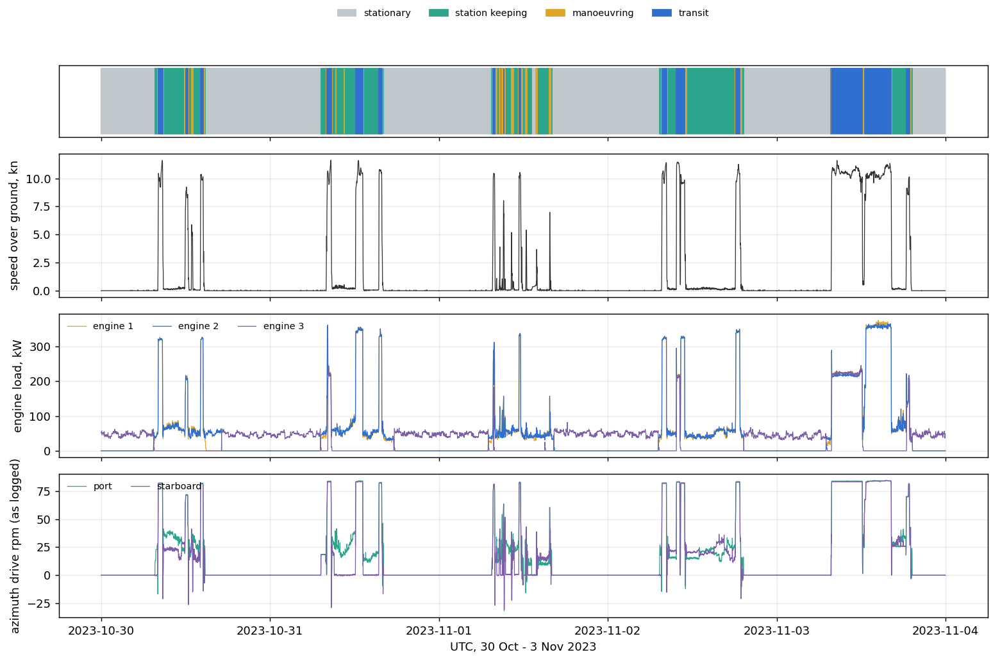

# Power and energy profile, 30 October – 3 November 2023

The operating profile of the power and energy system of RV Gunnerus over five days: when the three diesel engines ran, how they shared the load, what the two azimuth drives did and how much fuel went where, from the ship's own machinery log. One row per minute, with every minute classified into one of four operating modes.



## Source and credit

**The measurements** are the NUC logger data of the cruise week 44 of 2023 (Gunnerus, 30 Oct – 3 Nov), the same logger as in [`wave-shielding-2023`](../wave-shielding-2023/README.md). Tag names and units follow the NTNU page [*e-infrastructure*](https://www.ntnu.edu/gunnerus/e-infrastructure) (engine data: load in kW, fuel consumption in L/h, speed in rpm).

**No published study anchors this case.** The mode classification, the derived quantities and the assumed constants are ours, and every one of them is labelled as such (see [Measured, derived, assumed](#measured-derived-assumed)). If a study uses this week, cite it alongside this repository.

**Data provided by** [Robert Skulstad](https://www.ntnu.edu/employees/robert.skulstad) (NTNU): the raw NUC logger data of the cruise week. Part of the same week was used for the wave-shielding experiment of 31 October ([`wave-shielding-2023`](../wave-shielding-2023/README.md)), which is a separate case.

**Dataset organised by** Henrique M. Gaspar (NTNU), based on the data from Robert Skulstad: selection of the channels from the raw cruise data, 1-minute resolution, mode classification, documentation and the [web page](https://shiplab.github.io/gunnerus/power-energy.html).

## The case in Gunnerus terms

Gunnerus is diesel-electric: three diesel generator sets feed the electrical plant, which supplies two permanent-magnet azimuth drives at the stern, a tunnel thruster at the bow, and the hotel, hydraulic and deck loads. It is not a hybrid vessel; the equipment list has a battery box, but there is no battery data here.

| Item (list of main equipment) | On Gunnerus | Measured here |
| --- | --- | --- |
| 72 Main engine | 3 × 450 kW diesel engines (475 kW on the engine room arrangement, see [Known issues](#known-issues)) | load (kW), fuel consumption (L/h), speed (rpm), per engine |
| 73 Generator | 3 generator sets | – |
| 93 Main switchboard, 92 Transformer, 91 Battery box | Electrical distribution | – |
| 94, 95 Frequency converters | Frequency converters; we assume they feed the azimuth thrusters (94) and the bow thruster (95) | – |
| 47, 49, 51, 76 PM azimuth drives | Two, port and starboard | rpm and load feedback, as logged |
| 75 Bow tunnel thruster 200 kW | One | feedback in % (zero all week) |

Elsewhere in this repository: the [list of main equipment](../../extended/CJOB/docs/List%20of%20Main%20Equipment%20Rev0.pdf) and [specification](../../extended/CJOB/docs/Specification%20Rev0.pdf), the [engine room arrangement](../../extended/CJOB/Engine%20Room%20Arrangement%20Rev0.pdf), the [tank plan](../../polarkonsult/Tank%20Plan%20Rev1.pdf), and SFI group 6 (propulsion and machinery) in the [3D viewer](https://shiplab.github.io/gunnerus/) and the [ship explorer](https://shiplab.github.io/gunnerus/explorer.html), where the engines and azimuth drives link to their measured channels. The [web page](https://shiplab.github.io/gunnerus/power-energy.html) shows the power chain and marks which parts are measured.

## Operating modes

Each minute is assigned to one mode from measured speed over ground and azimuth rpm. These rules are **our choice**: we placed the cut-offs in the gaps of the 1-minute histograms of the week.

| Mode | Rule | Why this cut-off |
| --- | --- | --- |
| `transit` | speed ≥ 8 kn | cruising is a tight cluster at 8–12 kn; below it, minutes are acceleration and deceleration |
| `manoeuvring` | 0.5 kn ≤ speed < 8 kn | |
| `station_keeping` | speed < 0.5 kn and the larger azimuth rpm > 5 | azimuth rpm is idle (< 0.5) or running (> 8), almost nothing between |
| `stationary` | speed < 0.5 kn and azimuth drives idle | 5,945 of 7,195 minutes with speed data are below 0.3 kn: GPS noise floor |

The names are descriptive: the data does not say whether the ship lay alongside, at anchor or drifting, or whether a station-keeping minute was dynamic positioning. Minutes with missing speed or azimuth data have an empty mode.

## What the week looks like

All values are derived from the 1-minute data (`summary.csv`). *Energy* is engine load (kW) integrated over time, i.e. engine output; it is neither shaft power nor electrical power.

| Mode | Hours | Mean load, 3 engines (kW) | Engines running (mean) | Energy (kWh) | Fuel (L) | Share of fuel |
| --- | --- | --- | --- | --- | --- | --- |
| Stationary | 72.9 | 49 | 1.1 | 3,574 | 1,349 | 27 % |
| Station-keeping | 28.0 | 107 | 2.0 | 2,997 | 1,048 | 21 % |
| Manoeuvring | 4.3 | 139 | 2.1 | 602 | 197 | 4 % |
| Transit | 14.7 | 656 | 2.4 | 9,669 | 2,456 | 49 % |
| **Week** | **119.9** | **140** | **1.5** | **16,842** | **5,050** | **100 %** |

Transit is about 12 % of the time and about half of the fuel. Fuel per energy is 0.25 L/kWh in transit and rises to 0.38 L/kWh when stationary. Because the logged fuel looks computed from load (see below), this is the logger's relation, not a measured engine efficiency. Per day (30 Oct to 3 Nov) the fuel was 729, 896, 659, 937 and 1,829 L; 3 November has two long transits of about four hours at about 10 knots.

**Load sharing (derived from the three engine loads).** Engine 3 alone carries the stationary load, about 47 kW while running, and runs in 92 % of the stationary minutes (43 kW averaged over all of them); engines 1 and 2 are then off. In station-keeping, manoeuvring and transit, engines 1 and 2 share the load about equally. Engine 3 runs in about 40 % of the transit minutes, at about 212 kW while running (85 kW averaged over all transit minutes); on 3 November it carries part of the first long transit and is off in the second. Per-engine fuel per energy in the logger is about 0.26, 0.26 and 0.30 L/kWh for engines 1, 2 and 3. The data does not say why the engines are dispatched this way (operator choice, power management or load) and we do not assume a reason.

The wave-shielding experiment of 31 October (10:00–12:09 UTC, on DP) falls within this week; its minutes are in `data/power_1min.csv.gz`.

## From mission to performance

The case is organised the way a concept of operations is taught: **mission → operational profile → operational states → performance** (Gaspar, H. M., Hagen, A. and Erikstad, S. O. (2016), [*On designing a ship for complex value robustness*](https://doi.org/10.1080/09377255.2015.1119923), Ship Technology Research 63(1), 14–25, Fig. 7). Only the last two levels can be read from the data.

| Level | Here | In the data |
| --- | --- | --- |
| Mission | Why the ship is operated; Gunnerus is a research vessel | no |
| Operational profile | The cruise week, or one day of it | the period only; the logger does not say which minutes belong to which task |
| Operational states | The four modes above (stationary, station-keeping, manoeuvring, transit) | derived, with assumed thresholds; they describe motion, not tasks (*in port*, *stand-by* and *idle* all fall under stationary) |
| Performance | Fuel, engine energy, tank-to-wake CO₂, engines running, load sharing | derived, with assumed constants |

[`profile.csv`](profile.csv) holds the shares behind the charts of the web page, for the week and for each day (`kind`: `mode`, `speed_band`, `engines_running`, `engine_combination`, `engine`, `engine_by_mode`). Week values, all derived:

| Share of | Time | Engine energy | Fuel |
| --- | --- | --- | --- |
| Speed under 0.5 kn | 84 % | 39 % | 47 % |
| Speed 0.5 to 8 kn | 4 % | 4 % | 4 % |
| Speed 8 to 10 kn | 3 % | 12 % | 10 % |
| Speed 10 kn and above | 10 % | 46 % | 39 % |
| One engine running | 57 % | 19 % | 24 % |
| Two engines running | 37 % | 57 % | 55 % |
| Three engines running | 6 % | 24 % | 21 % |

The speed bands (under 0.5, 0.5–3, 3–6, 6–8, 8–10, 10 kn and above) are our choice. **Per engine** (share of the total engine energy): engine 1 37 %, engine 2 37 %, engine 3 26 %. Engine 3 runs 61 % of the time at a mean load of 60 kW while running; engines 1 and 2 run 43 % and 45 % of the time at about 118 kW. Relative to the rated 450 kW per engine (assumed, from the list of main equipment; 475 kW on the engine room arrangement) that is a mean load of 13 % for engine 3 and 26 % for engines 1 and 2 over the minutes they run. In transit engines 1 and 2 run at about 64 % of rated. Within each state the split of the engine energy is in `profile.csv` (`engine_by_mode`) and on the web page.

## Measured, derived, assumed

| Label | Meaning | Examples here |
| --- | --- | --- |
| **measured** | a logged channel, as logged, averaged over the minute | speed, GPS position, engine load, engine fuel consumption, engine rpm, azimuth rpm |
| **derived** | computed from measured data by a rule written in `extract.py` | mode, total load, energy, fuel per energy, hours, engines running |
| **assumed** | a choice of ours, not a measurement | mode cut-offs, speed bands, rated engine power 450 kW, fuel density 0.85 kg/L, CO₂ factor 3.206 t CO₂ per t fuel (marine gas oil), the links in the power-chain diagram |

`channels.csv` carries the label of every column. `summary.csv` gives `co2_t_assumed`, a **tank-to-wake** CO₂ estimate (fuel × density × factor; CO₂ only, no methane, nitrous oxide or upstream emissions, and the fuel grade is not recorded here). The `…_assumed` column names say so on purpose.

## Files

All times are UTC. Units and sources for every column are in [`channels.csv`](channels.csv).

| File | Contents | Rows |
| --- | --- | --- |
| [`data/power_1min.csv.gz`](data/power_1min.csv.gz) | One row per minute: mode, speed, position (latitude, longitude), three engines (load, fuel consumption, speed), two azimuth drives (rpm, load), tunnel thruster, engines running, total load, total fuel | 7,200 |
| [`cases.csv`](cases.csv) | Consecutive operating periods: start, end, duration, mode, mean speed and load, fuel | 134 |
| [`summary.csv`](summary.csv) | Derived totals per mode, per day and for the week | 30 |
| [`profile.csv`](profile.csv) | Shares of time, engine energy and fuel by mode, speed band and engines running, and per engine (share of energy, running time, load factor), per day and for the week | 195 |
| [`channels.csv`](channels.csv) | Data dictionary, with measured / derived status | 22 |
| [`figures/overview.png`](figures/overview.png) | Speed, engine load and azimuth rpm over the five days, coloured by mode | – |
| [`scripts/extract.py`](scripts/extract.py) | How these files were made from the raw cruise data | – |

Less than 1 MB in total. The website reads `pages/assets/operational/power-energy-2023.json`, also made by `extract.py` (step `web`).

### Load it

```python
import pandas as pd

d = pd.read_csv("data/power_1min.csv.gz", parse_dates=["time_utc"])
transit = d[d["mode"] == "transit"]
print(transit[["engine1_load_kw", "engine2_load_kw", "engine3_load_kw"]].mean())
print(d.groupby("mode").fuel_total_lph.sum() / 60)   # litres per mode
```

## Processing

The raw cruise data (about 9 GB for the whole week) is not in this repository. [`scripts/extract.py`](scripts/extract.py) reads the five daily NUC exports (`vessel data from nuc PC/second_try/Gunnerus-w44/copy1…copy5`, long format) and:

- keeps only the speed, engine, azimuth drive and tunnel thruster tags;
- takes the mean of the logged samples in each minute, **without** interpolation, so a minute with no sample stays empty (99.9 % of the minutes have data);
- assigns the mode, counts the engines running (load above 5 kW) and sums load and fuel, with the rules above;
- cuts the minutes into consecutive periods of one mode (`cases.csv`) and sums them (`summary.csv`);
- computes the shares of time, energy and fuel by mode, speed band and engine combination, and per engine (`profile.csv`).

Run `python3 operational/power-energy-2023/scripts/extract.py "<…>/Tokt uke 44 2023"` (pandas and numpy; matplotlib for the figure). The thresholds and constants are at the top of the script. Steps: `minute periods summary profile channels web figure`. Running only the `profile` step afterwards reads the rounded `power_1min.csv.gz` and can differ from a full run by a rounding step (0.01 in the last digit of some shares).

## Known issues

- **Fuel looks computed.** Fuel consumption and engine load correlate at about 1.00 for each engine, so the logger probably derives fuel from load instead of metering it. We have no supplier confirmation. Fuel totals and tank-to-wake figures inherit this.
- **Position.** Latitude and longitude come from the GPS (GGA sentence) and are logged as degrees and minutes (ddmm.mmmm). `extract.py` converts every sample to decimal degrees *before* averaging, because a mean taken across a whole-degree boundary (for example 5°59.9′ to 6°00.1′) gives a false position. There is no coastline or chart in the repository. The web page shows the track on the open map of [Kartverket](https://www.kartverket.no/), loaded from their servers when the page is opened (it needs an internet connection; without it, the page draws the track alone on a plain grid, north up). The hemisphere (N, E) is assumed from the position of the ship and the Seapath documentation.
- **Azimuth units.** The unit of the azimuth rpm and load feedback is not documented on the NTNU page; the columns are labelled "as logged".
- **No electrical data.** No generator, switchboard or battery measurement, and no fuel tank levels. The split of load between propulsion and hotel and deck loads cannot be measured from these channels.
- **Tunnel thruster is zero all week:** it was not used, or not logged correctly.
- **One-minute means** average out peaks and short transients; the engine data is logged at up to 10 Hz.
- **Rated engine power.** 450 kW in the list of main equipment and the specification; 475 kW on the engine room arrangement.
- **Mode boundaries flicker.** 35 of the 134 periods last two minutes or less, at mode boundaries. Merge short periods if you need cleaner segments.
- **Not a representative year.** Five days in autumn 2023 on one research vessel, including a wave-shielding experiment on 31 October.

## How to cite

Cite this repository as given in the [main README](../../README.md#how-to-cite). If a study uses this week of data, cite it too.

## Licence

The data in this folder is licensed [CC BY-NC 4.0](https://creativecommons.org/licenses/by-nc/4.0/), like the rest of the repository.
