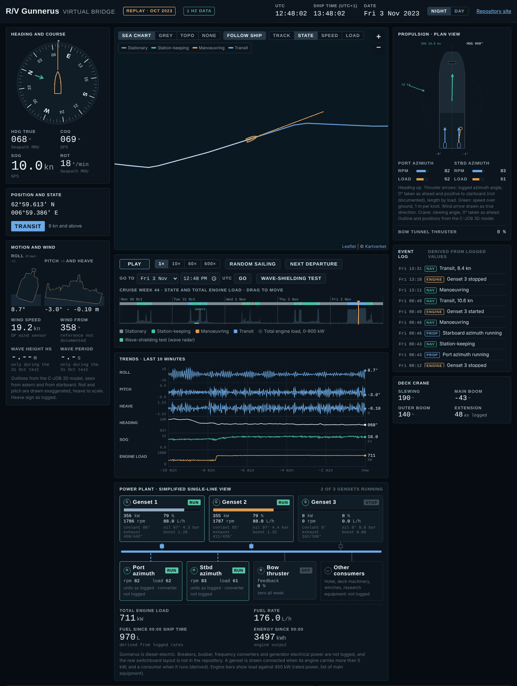

# Virtual bridge

A replay of R/V Gunnerus in operation, shown as a bridge display: chart, heading and course, motion, wind, a plan view of the thrusters, trends of the last ten minutes, power plant, crane and an event log. The page is [`pages/virtual.html`](../pages/virtual.html), published at <https://shiplab.github.io/gunnerus/virtual.html>.

[](https://shiplab.github.io/gunnerus/virtual.html)

*The virtual bridge on 3 November 2023 at 12:48 UTC: in transit at 10 knots, rolling 8.7°, two of the three gensets running. On the live page the chart shows Kartverket's sea chart under the track; the tiles are not part of this picture.*

The data are the logged values from the cruise week of **30 October to 3 November 2023**, replayed as if live. Nothing on the page is live. The page opens at a random moment while the ship is under way and plays at 10×; you can jump to any time, replay at 1× to 600×, colour the week's track by operating state, speed or engine load, and follow the event log. A link opens the replay at a given second, for example <https://shiplab.github.io/gunnerus/virtual.html#t=2023-11-03T12:48:02Z> (the *Link to this moment* button makes one); a linked moment plays at 1×.

Data provided by Robert Skulstad (NTNU, <https://www.ntnu.edu/employees/robert.skulstad>); organised by Henrique M. Gaspar. Part of the same week was used for the wave-shielding experiment ([`operational/wave-shielding-2023`](../operational/wave-shielding-2023/)).

## Phases

1. **Replay in the browser (now).** The page reads the files in `data/` and plays them back.
2. **Live feed (planned).** A small server publishes the same topics over MQTT, one value at a time, and the page subscribes over secure WebSockets. The files in `data/` already use the topic names and metadata that the server will publish, so the page only changes its source.

## Contents

| Path | Contents | Size |
| --- | --- | --- |
| `data/replay-2023-w44.json` | The whole week, one value per minute: position, speed, course from the track, operating state, engine load, fuel and speed, azimuth rpm and load, tunnel thruster. Used for the timeline, the event log and the fuel totals. | 0.7 MB |
| `data/replay-2023-10-30-1hz.json` … `replay-2023-11-03-1hz.json` | One file per UTC day: 52 logger signals at 1 Hz (navigation, motion, wind, azimuth drives, tunnel thruster, crane, three engines with temperatures and pressures). The page loads the day it is replaying. | 6.2–7.9 MB each |
| `data/replay-2023-10-31-wave-test.json` | Miros wave radar values during the wave-shielding test, 31 Oct 2023 10:00–12:10 UTC (the only wave data in the week). | 0.2 MB |
| `scripts/build_replay.py` | Builds the week file and the wave-test file from data already in this repository. | |
| `data/gunnerus-outline.json` | Outlines of the ship from above, from astern and from the side, and the positions of the azimuth drives, bow thruster and crane, for the plan view and the motion drawings. | 6 kB |
| `scripts/build_days.py` | Builds the 1 Hz day files from the raw logger export (not in this repository). | |
| `scripts/build_outline.mjs` | Builds the outline file from the 3D model in [`derived/3d/`](../derived/README.md) (Node.js). | |
| `images/virtual-bridge.png` | The screenshot above. | 0.2 MB |

The deploy workflow ([`.github/workflows/pages.yml`](../.github/workflows/pages.yml)) copies `data/*.json` to `assets/virtual/` on the website.

## Sources

| File | From |
| --- | --- |
| Week file | [`operational/power-energy-2023/data/power_1min.csv.gz`](../operational/power-energy-2023/) (1-minute means of the NUC logger; operating states and their rules are explained there). |
| Day files | The raw NUC logger export of the cruise week (`Gunnerus-w44/copy1` … `copy5`, long format `time, tag, value`, one file per UTC day, about 260 MB each). The raw files stay with the data owner. |
| Outline file | [`derived/3d/gunnerus.glb`](../derived/README.md), the C-JOB 3D model simplified by NTNU: envelopes of the mesh in 0.25–0.5 m slices, and bounding boxes of the parts. |
| Wave-test file | [`operational/wave-shielding-2023/data/wave_radar_params.csv`](../operational/wave-shielding-2023/) (Wang et al. 2025, *Ocean Engineering* 320, 120189). |

The day files were checked against [`operational/wave-shielding-2023/data/vessel_1hz.csv.gz`](../operational/wave-shielding-2023/), which comes from the same raw files: roll, heave and engine load are identical over the test window, heading and azimuth angle agree within 0.05° (stored here to 0.1°), latitude within 0.00005°.

## Message format (`gunnerus-virtual/1`)

Every signal is a **topic**, named `gunnerus/<system>/<unit>/<quantity>`, for example `gunnerus/engine/1/load`, `gunnerus/nav/mru/roll`, `gunnerus/azimuth/port/angle`. Each topic carries its own metadata:

| Field | Meaning |
| --- | --- |
| `unit` | Unit, or "as logged" where the documentation does not state it |
| `status` | `measured` (a logged channel) or `derived` (computed by a stated rule) |
| `source` | Logger tag or derivation rule |
| `rate` | How often the value is updated |
| `crosswalk` | Signal id in [`metadata/signals/gunnerus-signal-crosswalk.csv`](../metadata/signals/) (E02 engine power, N07 roll, T01 azimuth angle, …) |
| `scale` | (day files) number of decimals; values are stored as integers × 10^scale |
| `description` | What the value is, with known doubts |

A file holds a set of topics on one time grid: `t0` (UTC start), `dt` (seconds per step), `n` (steps), `topics` (metadata) and `data` (values). Two encodings are used:

- **Grid** (week file, wave-test file): `data[topic]` is a list of `n` values, `null` where nothing was logged.
- **Changes** (day files, `"encoding": "changes"`): the logger writes a value when it changes, so only the changes are stored. `data[topic]` is `{"t": [...], "v": [...]}`: `t` holds the seconds since the previous entry, `v` the value × 10^scale. A value holds until the next entry. Where no sample arrived for more than `gap_s` (30) seconds, a `null` entry marks the gap.

Decoding one topic of a day file in Python:

```python
import json, numpy as np
d = json.load(open("virtual/data/replay-2023-11-03-1hz.json"))
topic = "gunnerus/nav/mru/roll"
e, scale = d["data"][topic], d["topics"][topic]["scale"]
roll = np.full(d["n"], np.nan)            # one value per second from t0
t = np.cumsum(e["t"])
for k, (start, v) in enumerate(zip(t, e["v"])):
    end = t[k + 1] if k + 1 < len(t) else d["n"]
    if v is not None:
        roll[start:end] = v / 10 ** scale
```

Over MQTT (phase 2), a topic will carry one payload per value, `{"t": "2023-11-03T08:12:04Z", "v": 4.31, "unit": "deg", "status": "measured", "rate": "1 Hz", "crosswalk": "N07"}`, and the rest of the metadata once, as a retained message on `<topic>/$meta`. The page shows this message for any signal you select.

## Measured, derived, assumed

- **Measured:** every topic marked `measured`, as logged. No values are interpolated.
- **Derived:** operating state (from 60-second means of the 1 Hz speed and azimuth rpm, with the rules of the power and energy case: transit from 8 kn, manoeuvring from 0.5 kn, otherwise station-keeping if an azimuth runs above 5 rpm, else stationary), course from the 1-minute track while a day file is loading, the event log (genset start and stop, azimuth running or idle, state changes; changes shorter than 2 minutes for machinery and 3 minutes for the state are ignored), which gensets and consumers are drawn connected (engine load above 5 kW, azimuth rpm above 5), and fuel and energy since midnight ship time (logged rates summed second by second). The timeline of the week uses the 1-minute file.
- **Display only:** the ship symbol and the needles move smoothly between logged values; the roll and pitch drawings are exaggerated (×2 and ×3), heave is to scale. The trends show the last ten minutes of the 1 Hz values as logged.
- **Assumed:** ship time UTC+1 (CET, after 29 Oct 2023); azimuth angle 0° = ahead and positive to starboard; crane slewing angle 0° = ahead; wind direction drawn as true; positive roll = starboard down and positive pitch = bow up (Seapath convention); waterline at the normal operating draught, 2.5 m; engine rated power 450 kW for the load bars (list of main equipment; 475 kW on the engine room arrangement). Equipment positions in the plan view are approximate (from the 3D model).

## Known issues

- The logger writes on change. Heading, heave and some engine values arrive every 2–3 s rather than every second; the page holds the last value.
- Units are not documented for the azimuth rpm and load feedback, the crane extension (documented in metres, values suggest centimetres) and several engine channels; they are shown "as logged". See the Sensors page (`pages/signals.html`) for these traps.
- The zero reference of the azimuth angles and the reference of the wind direction (relative or true) are not documented.
- Which physical engine is "engine 1, 2, 3" in the logger is not verified (two vendor documents number the registers differently).
- Engine fuel rates correlate 1.00 with load: probably computed by the logger, not metered.
- The bow tunnel thruster reads zero all week.
- Breakers, busbar, frequency converters, generator electrical power and hotel load are not logged; the power plant view is simplified and the real switchboard layout is not in this repository.
- Wave radar values exist only for the 31 Oct test. WaveX and RangeFinder disagree (about 1.7 m against 0.7 m); the study uses the RangeFinder.

## Rebuilding

From the repository root (pandas, numpy):

```sh
python3 virtual/scripts/build_replay.py                       # week file and wave-test file
python3 virtual/scripts/build_days.py "<…>/Gunnerus-w44"      # day files from the raw export, about 20 s per day
node virtual/scripts/build_outline.mjs derived/3d/gunnerus.glb derived/3d/gunnerus-parts.json virtual/data/gunnerus-outline.json
```

The outline script needs `npm install @gltf-transform/core@4 @gltf-transform/extensions@4 meshoptimizer@0.21.0`.

Preview: serve the repository root (`python3 -m http.server 8000`) and open <http://localhost:8000/pages/virtual.html>. The page finds the data in `../virtual/data/` when it is not deployed.

## Licence

The data in this folder is licensed [CC BY-NC 4.0](https://creativecommons.org/licenses/by-nc/4.0/), like the rest of the repository. Chart tiles on the page are loaded from Kartverket (© Kartverket) and are not stored here.
